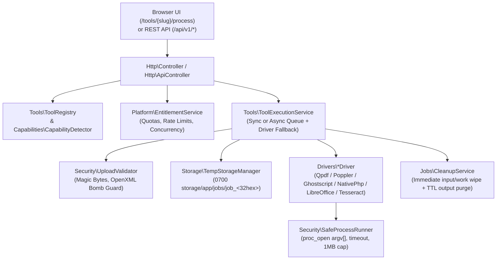

# Docvera System Architecture

Docvera is a **privacy-first, self-hosted document processing platform and REST API** written in strict, zero-bloat PHP 8.2+. Every tool available in the web workbench (`/tools/{slug}`) and the versioned REST API (`/api/v1/*`) runs through a single unified pipeline with strict input validation, capability detection, isolated subprocess execution, and deterministic temporary file cleanup.

---

## 1. High-Level Request & Processing Flow



---

## 2. Core Subsystems & Directory Layout

```text
docvera/
├── bin/                        # Operational CLI utilities
│   ├── capabilities            # Host binary & tool readiness matrix (--json supported)
│   ├── cleanup                 # Deterministic TTL cleanup for expired jobs & staging dirs
│   ├── install                 # Pre-flight environment checker & CLI installer
│   ├── migrate                 # Idempotent database schema migrator
│   ├── package-release         # Clean distribution archive builder & verifier
│   ├── test                    # 45+ integration, output-verification, & security test suite
│   └── worker                  # Asynchronous job queue worker (--once / --daemon)
├── config/
│   └── app.php                 # Environment-backed configuration defaults
├── database/
│   └── migrations/             # SQL & file-store migrations (001, 002)
├── docs/
│   ├── ARCHITECTURE.md         # System architecture & contributor guide
│   ├── DOCUMENTATION.md        # Operator, deployment, & API reference manual
│   └── screenshots/            # Real product screenshots
├── public/
│   ├── index.php               # Single HTTP entrypoint (with path-traversal guard)
│   └── assets/                 # Vanilla CSS & JS workbench assets
├── src/
│   ├── Api/                    # OpenAPI 3.1.0 & live endpoint documentation generator
│   ├── Auth/                   # Session, API key (HMAC-SHA256), & Principal resolution
│   ├── Billing/                # Optional Stripe & PayPal providers + webhook verification
│   ├── Capabilities/           # Runtime & CLI binary detector (CapabilityDetector)
│   ├── Core/                   # Application container, Config, & .env loader
│   ├── Database/               # Dual persistence engine (flock JSON store + PDO SQLite/MySQL)
│   ├── Drivers/                # Document processing drivers (ProcessingDriverInterface)
│   ├── Http/                   # Web, API (/api/v1/*), Admin (/admin/*), & Install controllers
│   ├── Inspection/             # PDF structure & page-range inspector (PdfInspector)
│   ├── Jobs/                   # TTL & user-initiated cleanup service (CleanupService)
│   ├── Platform/               # Plan quotas, rate limits, & concurrency (EntitlementService)
│   ├── Security/               # UploadValidator, SafeProcessRunner, CsrfGuard
│   ├── Storage/                # Ephemeral 0700 job workspace manager (TempStorageManager)
│   └── Tools/                  # ToolRegistry, ToolDefinition, & ToolExecutionService
├── storage/                    # Isolated runtime state (outside public web root)
│   ├── app/database/           # Default JSON store or SQLite database
│   ├── app/jobs/               # Ephemeral 0700 per-job workspaces (job_<32hex>)
│   ├── app/staged/             # Ephemeral 30-min Smart File Router staging
│   └── logs/                   # Structured JSONL operational logs
├── tests/
│   └── DocveraTestSuite.php    # Self-contained integration & security regression suite
└── views/                      # Server-rendered HTML templates (zero external JS frameworks)
```

---

## 3. Detailed Component Responsibilities

### 3.1 Capability Detection (`src/Capabilities/CapabilityDetector.php`)
- Probes required PHP extensions (`php_runtime`, `ext_mbstring`, `ext_json`, `ext_fileinfo`, `ext_zip`, `ext_gd`, `writable_storage`) and optional host binaries (`ghostscript`, `poppler`, `qpdf`, `libreoffice`, `tesseract`).
- Executes binary version checks (`--version` or `-v`) through `SafeProcessRunner` with a 4-second timeout.
- Supports explicit path overrides in `.env` (`BIN_GS`, `BIN_QPDF`, `BIN_PDFINFO`, `BIN_PDFTOPPM`, `BIN_PDFTOTEXT`, `BIN_PDFSEPARATE`, `BIN_PDFUNITE`, `BIN_LIBREOFFICE`, `BIN_TESSERACT`) and forced disablement via `__DISABLED__` (used in tests to simulate missing host binaries).

### 3.2 Tool Registry & Driver Fallback (`src/Tools/ToolRegistry.php` & `ToolExecutionService.php`)
- Defines all **22 document tools** with their accepted MIME types, extensions, file count bounds, option fields (`OptionField`), and ordered `candidateDrivers`.
- Examples of driver fallback chains:
  - `merge-pdf`: `['qpdf', 'poppler', 'ghostscript']`
  - `split-pdf`: `['poppler', 'ghostscript']`
  - `extract-pages`, `delete-pages`, `reorder-pages`, `rotate-pages`, `protect-pdf`, `unlock-pdf`: `['qpdf', 'ghostscript']`
- During execution, `ToolExecutionService::executeWithDriverFallback()` attempts the primary active driver first and automatically falls back to secondary candidate drivers on the host if a driver throws a runtime error (for example, when `pdfinfo`/`pdfseparate` is present for Poppler detection but `pdfunite` is absent during `every_n` splitting).

### 3.3 Hostile-Input Validation (`src/Security/UploadValidator.php`)
Every uploaded file passes five sequential checks before any driver touches it:
1. **Batch & Size Limits:** Enforces `minFiles`, `maxFiles`, and per-plan/per-tool `max_file_size_mb`.
2. **Filename Sanitization:** Strips path components (`basename`), control characters, and leading dots or hyphens (`-`) so a filename can never be interpreted as a CLI flag.
3. **Extension Allowlist:** Checks normalized lowercase extension against `$tool->supportedExtensions`.
4. **Magic-Byte MIME Detection (`finfo_file`):** Verifies the actual file content MIME type against `$tool->supportedMimes` (handling controlled OpenXML alias families where `finfo` reports `application/zip`).
5. **Format-Specific Header & Archive Bomb Guards:**
   - **PDFs:** Verifies `%PDF-` signature within the first 1,024 bytes.
   - **Images:** Verifies JPEG (`\xFF\xD8\xFF`), PNG (`\x89PNG\r\n\x1A\n`), GIF (`GIF87a`/`GIF89a`), or WebP (`RIFF....WEBP`) magic bytes.
   - **Legacy Office (`.doc`, `.xls`, `.ppt`):** Verifies OLE2 Compound Document header (`\xD0\xCF\x11\xE0\xA1\xB1\x1A\xE1`).
   - **OpenXML (`.docx`, `.xlsx`, `.pptx`):** Opens the ZIP container via `ZipArchive` and enforces:
     - Entry count `<= 2,500`
     - Total uncompressed size `<= 250 MB`
     - Compression ratio `<= 100:1` (for uncompressed payloads `> 10 MB`)
     - Zero path traversal (`..`, leading `/`, or `\`) in entry names
     - Presence of `[Content_Types].xml` and expected document structure (`word/`, `xl/`, or `ppt/`).

### 3.4 Isolated Subprocess Runner (`src/Security/SafeProcessRunner.php`)
- Uses `proc_open($commandArray, ...)` with `bypass_shell => true`. **No shell command strings are ever constructed.**
- Runs inside a restricted environment (`PATH`, `LANG=C.UTF-8`, `LC_ALL=C.UTF-8`, `HOME=$cwd`, `TMPDIR=$cwd`, `OMP_THREAD_LIMIT=2`).
- Polls non-blocking pipes with a strict wall-clock timeout, caps `stdout` and `stderr` capture buffers at `1 MB` each, and terminates timed-out process groups (`posix_kill(-$pid, 9)` + `proc_terminate`).

### 3.5 Ephemeral Storage & Privacy Model (`src/Storage/TempStorageManager.php` & `src/Jobs/CleanupService.php`)
- Every job is allocated a random `job_<32hex>` identifier and an isolated directory tree under `storage/app/jobs/job_<32hex>/{input,work,output}` with `0700` permissions.
- Uploaded files are stored under deterministic names (`input_001_<random>.pdf`).
- Inside a `finally` block in `ToolExecutionService`, `input/` and `work/` are **immediately purged** as soon as the driver finishes (or fails).
- Sensitive request parameters (`user_password`, `password`) and internal file paths (`staged_inputs`) are scrubbed from job records upon completion or failure.
- Output files remain in `output/` only until the user clicks **Delete File Now** (`POST /jobs/{id}/delete` or `DELETE /api/v1/jobs/{id}`) or until the retention TTL expires (`CleanupService::purgeExpired()`).

---

## 4. Adding a New Tool or Driver

### Step 1: Add or Extend a Driver (`src/Drivers/`)
Implement `Docvera\Drivers\ProcessingDriverInterface` (or add a tool branch to an existing driver such as `QpdfDriver` or `GhostscriptDriver`):
```php
public function process(
    ToolDefinition $tool,
    array $inputs,
    array $options,
    string $workDir,
    string $outputDir
): DriverResult;
```
- Write all intermediate scratch files into `$workDir`.
- Write the final artifact into `$outputDir`.
- Verify that the output file exists and `filesize($outputPath) > 0` before returning `DriverResult`.

### Step 2: Register the Tool (`src/Tools/ToolRegistry.php`)
Add a `new ToolDefinition(...)` entry in `ToolRegistry::all()` and map its REST API route in `ToolRegistry::getApiRouteMap()`.
Because Docvera is registry-driven, adding a `ToolDefinition` automatically:
- Renders the tool card on `/` and in the Smart File Router (`/router/inspect`)
- Serves the dedicated workbench UI at `/tools/{slug}`
- Exposes `POST /api/v1/tools/{slug}` and its semantic alias route
- Generates interactive API documentation at `/developers/api` and OpenAPI 3.1.0 schema at `/api/v1/openapi.json`
- Adds administrative toggles in `/admin/tools`

### Step 3: Add Output-Verifying Tests (`tests/DocveraTestSuite.php`)
Add an integration test in `tests/DocveraTestSuite.php` that executes the tool and inspects the resulting artifact (page count, dimensions, text content, or encryption status). Run `php bin/test` to verify.

